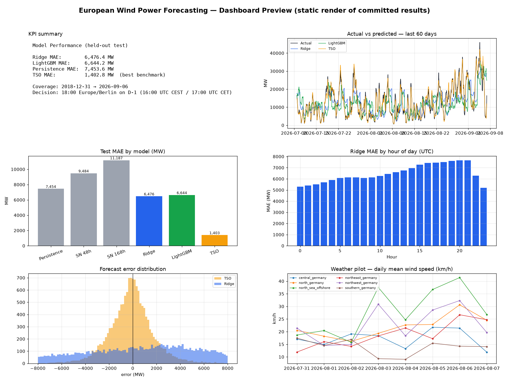

# European Wind Power Forecasting & Market Analytics

> Hourly wind-power generation forecasting for the **DE-LU** (Germany + Luxembourg)
> bidding zone, built end-to-end as a reproducible Data Science project for a
> Junior Data Scientist role at an electricity trading company.

[](https://www.python.org/)
[](LICENSE)
[](https://creativecommons.org/licenses/by/4.0/)

---

## 1. Project Overview

Electricity traders need accurate short-term predictions of wind generation to
make better decisions in the day-ahead market. This project builds a Machine
Learning system that:

1. Predicts **hourly wind power generation** for DE-LU for the next 24 hours.
2. Compares predictions against **actual** generation.
3. Benchmarks the models against the **official ENTSO-E TSO day-ahead wind forecast**.
4. Analyzes how **wind forecast errors relate to day-ahead electricity prices**.

The system is designed around a strict **forecast decision time of 18:00
Europe/Berlin on the day before delivery**, with every feature masked against
that cutoff to prevent look-ahead bias.

### Headline result

**The official TSO day-ahead forecast is the strongest benchmark in this
experiment.** The machine-learning models improve on the persistence baseline but
do **not** outperform the TSO forecast.

| Model | Test MAE (MW) | Test RMSE (MW) | Bias (MW) | Mean-normalized MAE | Δ vs persistence |
|---|---|---|---|---|---|
| Persistence | 7,453.6 | 9,943.1 | +443.9 | 0.490 | — |
| Seasonal naive 48 h | 9,484.0 | 12,302.0 | +16.2 | 0.624 | −27.2% |
| Seasonal naive 168 h | 11,186.8 | 14,248.1 | −119.1 | 0.736 | −50.1% |
| **Ridge** | **6,476.4** | **8,410.1** | −311.4 | 0.426 | **+13.1%** |
| LightGBM | 6,644.2 | 8,729.2 | −545.0 | 0.437 | +10.9% |
| **TSO official** | **1,402.8** | **1,996.3** | −101.8 | 0.092 | **+81.2%** |

**Mean-normalized MAE** = MAE / mean(actual generation). It is **not** an
installed-capacity nMAE; reliable time-dependent DE-LU installed-capacity data is
not available in this project.

---

## 2. Business Problem

Day-ahead electricity prices are highly sensitive to wind generation. A wind
forecast error of a few gigawatts can move prices substantially. Traders need to
know not only *how much* wind is expected, but *how uncertain* that forecast is
and *how* the uncertainty maps to price risk.

This project delivers:

- A leakage-free day-ahead forecasting pipeline.
- A reproducible benchmark against the official TSO forecast.
- An EDA of wind/price relationships.
- An interactive dashboard for technical review.

---

## 3. Data Sources

| Source | Role | Access |
|---|---|---|
| **DE-LU day-ahead snapshot** (`snapshot.parquet`) | Primary historical dataset: actual wind, TSO wind forecast, day-ahead price, load forecast | Committed public snapshot (CC BY 4.0) |
| **Open-Meteo Single Runs API** | Weather forecast model data (ECMWF IFS HRES 9 km) | Free, no key required |
| **ENTSO-E Transparency Platform** | Upstream origin of the snapshot (via Bundesnetzagentur / SMARD) | Free API key (not required for the committed snapshot) |

The snapshot is stored under `data/raw/` and is **git-ignored**. Provenance files
and the data dictionary are committed under `docs/data_sources/delu_snapshot/`.

---

## 4. Dataset Description

| Property | Value |
|---|---|
| Coverage | **2019-01-01 → 2026-09-06** (Europe/Berlin delivery days) |
| Rows × columns | **67,343 × 22** (raw) → **67,343 × 37** (processed) |
| Frequency | Hourly, UTC-indexed, no gaps, no duplicates |
| Timestamp convention | `timestamp_utc` = **interval start** |
| Target | `wind_total_actual_mw` = onshore + offshore actual generation |
| Benchmark | `wind_total_forecast_mw` = onshore + offshore TSO forecast |
| Price | `price_eur_mwh` (day-ahead); negative prices retained |
| Missing target | 1 row (`2025-07-09 18:00 UTC`), preserved as NaN |
| Missing load forecast | 194 rows (0.29%), documented, not imputed |
| DST | 23-hour (2026-03-29) and 25-hour (2025-10-26) days preserved |

Full column definitions, units, and quality notes are in
[`data_dictionary.md`](data_dictionary.md).

---

## 5. Technical Architecture

```
data/raw/snapshot.parquet
        │  (read-only)
        ▼
src/data/preprocess.py ──► data/processed/de_lu_hourly.parquet
        │                         + preprocessing_report.json
        ▼
src/models/features.py ──► calendar / cyclical / horizon / H+1-safe lags
        ▼
src/models/baselines.py ──► persistence, seasonal naive 48 h / 168 h
src/models/train.py     ──► Ridge, LightGBM  (validation-based selection)
        ▼
reports/model_comparison.csv · phase4_summary.json · figures/
        ▼
reports/dashboard_results.parquet · dashboard_metadata.json
        ▼
src/dashboard/app.py ──► Streamlit dashboard (reads only reports/)
```

**Stack:** Python 3.12 · pandas · NumPy · scikit-learn · LightGBM ·
Plotly · Streamlit · pytest.

---

## 6. Data Preparation

`src/data/preprocess.py` performs:

- Read-only load of the raw snapshot; **never modifies it** (SHA-256 verified).
- UTC `DatetimeIndex`; chronological and hourly-frequency validation.
- Derived target and benchmark columns.
- `decision_time_utc` = 18:00 Europe/Berlin on D-1.
- **H+1 publication rule**: an actual observation starting at `t` is usable only
  when `t + 1h <= decision_time`.
- Decision-time lag/rolling features and hour-specific 48 h / 168 h lags, all
  masked against the cutoff.
- Chronological `train` / `validation` / `test` split **by delivery date**.

Outputs: `data/processed/de_lu_hourly.parquet` and
`data/processed/preprocessing_report.json` (both git-ignored).

---

## 7. EDA Findings

From `notebooks/01_eda.ipynb` (executed; figures in `reports/figures/`):

- **Strong seasonality:** winter mean ≈ 20,900 MW vs summer ≈ 9,800 MW.
- **Onshore vs offshore:** onshore ≈ **80.6%** of generation, offshore ≈ 19.4%.
- **TSO forecast skill:** MAE ≈ 1,301 MW, RMSE ≈ 1,827 MW, mean-normalized MAE ≈ 0.088.
- **Wind vs price:** Pearson correlation ≈ **−0.26** (strongest in winter, −0.40).
- **Autocorrelation:** daily lag-1 ≈ 0.68, lag-7 ≈ 0.23, lag-365 ≈ 0.21.
- **Missing data:** negligible (1 target row, 194 load-forecast rows); no
  interpolation applied.

---

## 8. Models and Methodology

**Splits (chronological, no shuffling):**

| Split | Delivery dates | Eligible rows |
|---|---|---|
| train | 2019-01-01 → 2022-12-31 | 34,872 |
| validation | 2023-01-01 → 2024-12-31 | 17,544 |
| test | 2025-01-01 → 2026-09-06 | 14,731 |

**Features (available at decision time only):**

- Calendar and cyclical encodings (hour, day-of-week, month, season).
- Forecast horizon (valid time − decision time).
- Decision-time wind lags (1/24/48/168 h) and 24 h rolling mean/std.
- Hour-specific 48 h and 168 h wind lags.

**Excluded to prevent leakage:** contemporaneous actual generation (the target),
the TSO forecast, day-ahead price, load forecast (publication time not verified),
and the 7-day weather pilot.

**Models:** Ridge Regression (StandardScaler + Ridge) and LightGBM Regressor.
Model selection uses **validation MAE**; the test set is touched once.

**Metrics:** MAE, RMSE, bias, mean-normalized MAE, and improvement over the
persistence baseline.

---

## 9. Actual Test Results

See the headline table in §1. Validation MAE: Ridge **6,703.5 MW**, LightGBM
**6,911.0 MW** → Ridge selected. Full artifacts:
`reports/model_comparison.csv` and `reports/phase4_summary.json`.

---

## 10. TSO Comparison

The official TSO day-ahead wind forecast achieves **MAE 1,402.8 MW** and
**RMSE 1,996.3 MW** on the same 14,731 test observations — substantially better
than every model in this experiment. It is kept as an **independent benchmark**
and is **not** used as a model input. No claim is made that the ML models
outperform the TSO forecast.

---

## 11. Dashboard

A Streamlit dashboard reads only the committed artifacts under `reports/` and
never re-trains models.



*Static preview rendered from the committed evaluation results (a headless
browser screenshot is not available in this environment). The live app renders
the same data interactively.*

### Run the dashboard

```bash
streamlit run src/dashboard/app.py
```

Then open the local URL printed by Streamlit (default `http://localhost:8501`).

Sections: Project Overview · Model Performance · Actual vs Predicted ·
Error Analysis · Data Quality & Methodology · Weather Pilot.

---

## 12. Limitations

- **TSO is stronger:** the ML models do not outperform the official TSO forecast.
- **No installed-capacity nMAE:** reliable time-dependent DE-LU capacity data is
  unavailable; only mean-normalized MAE is reported.
- **Price/load excluded:** their publication timestamps are not in the snapshot.
- **Weather not used historically:** the 7-day Open-Meteo pilot validates the
  collection pipeline only.
- **Snapshot cutoff:** the historical data ends on **2026-09-06**.
- **Spatial aggregation:** the six weather grid points are illustrative and not
  capacity-weighted.

---

## 13. Reproducibility

The committed `reports/` artifacts let the dashboard run on a fresh clone without
the raw data or model binaries. To regenerate everything from scratch:

```bash
# 1. Create environment
py -3.12 -m venv .venv
.\.venv\Scripts\Activate.ps1

# 2. Install
python -m pip install --upgrade pip
pip install -r requirements.txt

# 3. Configure secrets (only needed for live ENTSO-E collection)
copy .env.example .env

# 4. Obtain the raw snapshot (see docs/data_sources/delu_snapshot/README.md)
#    and place it at data/raw/snapshot.parquet

# 5. Preprocess + EDA
python -m src.data.preprocess

# 6. Train, evaluate, export dashboard artifacts
python -m src.models.train

# 7. Test
pytest

# 8. Dashboard
streamlit run src/dashboard/app.py
```

The raw snapshot is **not** committed. Download it from the upstream repository
documented in `docs/data_sources/delu_snapshot/README.md` and verify its SHA-256.

---

## 14. Installation and Execution Commands

| Task | Command |
|---|---|
| Create venv | `py -3.12 -m venv .venv` |
| Activate (Windows) | `.\.venv\Scripts\Activate.ps1` |
| Install | `pip install -r requirements.txt` |
| Preprocess | `python -m src.data.preprocess` |
| Train & evaluate | `python -m src.models.train` |
| Tests | `pytest` |
| Dashboard | `streamlit run src/dashboard/app.py` |

---

## 15. Data Attribution and Licensing

- **Code:** MIT License — see [LICENSE](LICENSE).
- **Historical electricity data:** derived from the ENTSO-E Transparency Platform
  and Bundesnetzagentur | SMARD.de, redistributed under **CC BY 4.0**.
- **Weather data:** Open-Meteo.com (CC BY 4.0), ECMWF IFS HRES 9 km.

> Data: ENTSO-E Transparency Platform; Bundesnetzagentur | SMARD.de — CC BY 4.0.
> Weather data: Open-Meteo.com (CC BY 4.0), ECMWF IFS HRES 9km.

---
## About Me

**Yahia Eid Hassan El-Samman**  
Recent Graduate | Artificial Intelligence, Machine Learning & Data Science

I am a 2026 graduate of Assiut University, Faculty of Commerce, specializing in Public Policy Information Systems (PPIS), with a strong focus on Artificial Intelligence, Machine Learning, and Data Science.

I enjoy building practical, data-driven solutions and working on end-to-end projects involving data analysis, predictive modeling, and intelligent systems.

**Technical Interests**
- Machine Learning & Predictive Analytics
- Data Science & Statistical Analysis
- Time Series Forecasting
- Generative AI & Intelligent Applications
- Data Visualization & Business Intelligence

**Technologies & Tools**

Python · SQL · Pandas · NumPy · Scikit-learn · LightGBM · PyTorch · TensorFlow · Power BI · Tableau · Git · GitHub

**GitHub:** [github.com/yahia1610](https://github.com/yahia1610)
